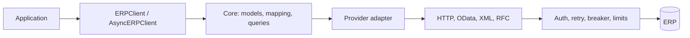

# py-erp-bridge

One typed Python SDK for ten ERP systems: the same calls, models, errors and reliability features,
whichever ERP is behind them.

> **Status: alpha.** Every adapter is tested against mocked servers; **none has been run against a live
> ERP**. Some wire details could not be confirmed in vendor documentation and are marked as such in
> [capabilities](docs/capabilities.md). Start in a sandbox. Details: [status](docs/status.md).

## Features

- Sync and async clients over one implementation, fully typed (Pydantic v2, mypy strict)
- Canonical models that keep the original payload in `raw`
- Basic, bearer, API key, OAuth 2.0 (client credentials, authorization code with PKCE, password, JWT
  assertion), OAuth 1.0a, plugins
- Retry with backoff and jitter, `Retry-After`, circuit breaker, rate and concurrency limits, timeouts,
  pooling, proxies, mutual TLS
- Pagination, filtering, sorting, bulk creation, incremental sync, webhooks, tenants
- REST, OData v2 and v4 with batches, SOAP, XML, JSON-RPC, SAP RFC
- Structured logs, metrics hook, health checks
- Third-party providers through a registry or entry points

## Providers

| Provider | Name | Protocols | Authentication | Bulk | Guide |
|---|---|---|---|---|---|
| SAP S/4HANA | `sap_s4hana` | OData v2, SOAP | Basic, OAuth 2.0 | `$batch` | [guide](docs/providers/sap_s4hana.md) |
| SAP ECC | `sap_ecc` | RFC | RFC logon, SNC | single | [guide](docs/providers/sap_ecc.md) |
| Oracle Fusion Cloud ERP | `oracle_fusion` | REST, SOAP | Basic, OAuth 2.0 | single | [guide](docs/providers/oracle_fusion.md) |
| Oracle NetSuite | `netsuite` | REST, SuiteQL | JWT assertion, OAuth 2.0, TBA | single | [guide](docs/providers/netsuite.md) |
| Dynamics 365 F&O | `dynamics365` | OData v4 | OAuth 2.0 | `$batch` | [guide](docs/providers/dynamics365.md) |
| Odoo | `odoo` | JSON-2, JSON-RPC | API key | native | [guide](docs/providers/odoo.md) |
| ERPNext | `erpnext` | REST | API key, OAuth 2.0 | single | [guide](docs/providers/erpnext.md) |
| TallyPrime | `tally` | XML over HTTP | none | single | [guide](docs/providers/tally.md) |
| Infor CloudSuite (M3) | `infor` | REST (ION API) | OAuth 2.0 | native | [guide](docs/providers/infor.md) |
| Sage Intacct | `sage_intacct` | REST | OAuth 2.0 | single | [guide](docs/providers/sage_intacct.md) |

### Operations

L list, G get, C create, U update, D delete, - not mapped. Full detail: [capabilities](docs/capabilities.md).

| Entity | S/4 | ECC | Fusion | NetSuite | D365 | Odoo | ERPNext | Tally | Infor | Intacct |
|---|---|---|---|---|---|---|---|---|---|---|
| customers | LGU | LG | LGCU | LGCUD | LGCUD | LGCUD | LGCUD | LGCU | LGCU | LGCUD |
| vendors | LGU | LG | LGCU | LGCUD | LGCUD | LGCUD | LGCUD | LGCU | LG | LGCUD |
| products | LGCU | LG | LGCU | LGCUD | LGCU | LGCUD | LGCUD | LGCU | LG | LGCUD |
| inventory | L | L | L | - | - | LG | LG | LG | - | - |
| sales_orders | LGCUD | LGC | LGCU | LGCUD | LGCUD | LGCUD | LGCUD | LG | LG | - |
| purchase_orders | LGCUD | LGC | LG | LGCUD | LGCUD | LGCUD | LGCUD | LG | LG | - |
| invoices | LG | LG | LGCU | LGCUD | L | LGCUD | LGCUD | LG | - | LGCUD |
| payments | - | - | LG | LGCUD | - | LGCUD | LGCUD | LG | - | LG |
| employees | - | - | LG | LGCUD | - | LGCUD | LGCUD | - | - | LGCUD |
| financial_records | LG | LG | LG | LGCUD | LGCUD | LG | LG | LG | - | LGCUD |

## Architecture



More diagrams: [architecture](docs/architecture.md).

## Installation

```bash
pip install py-erp-bridge          # once published; until then: pip install .
pip install "py-erp-bridge[jwt]"   # NetSuite machine-to-machine OAuth
```

Python 3.11+. SAP RFC needs extra software: [SAP RFC](docs/sap-rfc.md).

## Quick start

```python
from py_erp_bridge import ERPClient

with ERPClient(
    provider="sap_s4hana",
    config={
        "base_url": "https://my300000-api.s4hana.ondemand.com",
        "auth": {"type": "basic", "username": "user", "password": "password"},
    },
) as erp:
    print(erp.test_connection())
    for customer in erp.customers.iterate(filters={"name__contains": "Acme"}, limit=10):
        print(customer.id, customer.name, customer.raw)

    order = erp.sales_orders.create(
        {
            "customer_id": "1001",
            "items": [{"product_id": "TG11", "quantity": "1"}],
            "provider_fields": {"SalesOrderType": "OR"},
        }
    )
```

```python
async with ERPClient.create_async(provider="odoo", config=config) as erp:
    customers = await erp.customers.get_all()
```

## Authentication

```python
basic = {"type": "basic", "username": "u", "password": "p"}
api_key = {"type": "api_key", "prefix": "token ", "key": "KEY:SECRET"}
oauth = {
    "type": "oauth2_client_credentials",
    "token_url": "https://login.microsoftonline.com/TENANT/oauth2/v2.0/token",
    "client_id": "...",
    "client_secret": "...",
    "scope": "https://ORG.operations.dynamics.com/.default",
}
```

Everything else: [authentication](docs/authentication.md). Environment variables: [`.env.example`](.env.example).

## Errors

```python
from py_erp_bridge.exceptions import APIError, NotFoundError, RateLimitError, TransportError

try:
    erp.customers.get("1001")
except NotFoundError:
    ...
except RateLimitError as exc:
    print(exc.retry_after)
except APIError as exc:
    print(exc.status_code, exc.code, exc.request_id)
except TransportError as exc:
    print(exc.request_sent)  # True: the outcome of a write is unknown
```

Creates are repeated only if the ERP certainly did not process them. See [errors](docs/errors.md).

## Documentation

All topics: [docs](docs/README.md). Runnable code: [examples](examples).

## Testing

```bash
pip install -e ".[dev]"
ruff format --check . && ruff check . && mypy && pytest
```

## Contributing

See [CONTRIBUTING](CONTRIBUTING.md).

## Publishing

```bash
python -m build
twine check --strict dist/*
twine upload --repository testpypi dist/*
```

Full procedure: [publishing](docs/publishing.md).

## Official references

| Provider | Documentation |
|---|---|
| SAP S/4HANA | <https://api.sap.com/products/SAPS4HANACloud/apis>, <https://help.sap.com/docs/SAP_S4HANA_CLOUD> |
| SAP ECC | <https://support.sap.com/en/product/connectors/nwrfcsdk.html>, <https://github.com/SAP-archive/PyRFC> |
| Oracle Fusion | <https://docs.oracle.com/en/cloud/saas/financials/> |
| NetSuite | <https://docs.oracle.com/en/cloud/saas/netsuite/ns-online-help/chapter_1540391670.html> |
| Dynamics 365 | <https://learn.microsoft.com/dynamics365/fin-ops-core/dev-itpro/data-entities/odata> |
| Odoo | <https://www.odoo.com/documentation/19.0/developer/reference/external_api.html> |
| ERPNext | <https://docs.frappe.io/framework/user/en/api/rest> |
| TallyPrime | <https://help.tallysolutions.com/xml-interface/> |
| Infor | <https://docs.infor.com/>, <https://github.com/infor-cloud/ion-api-sdk> |
| Sage Intacct | <https://developer.sage.com/intacct> |

## License

[MIT](LICENSE)
