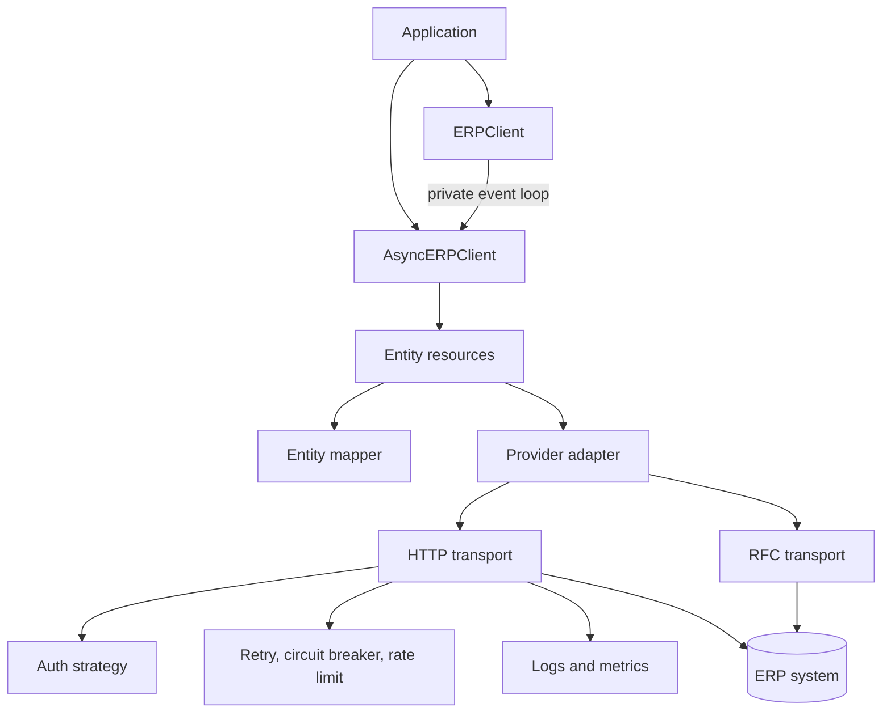
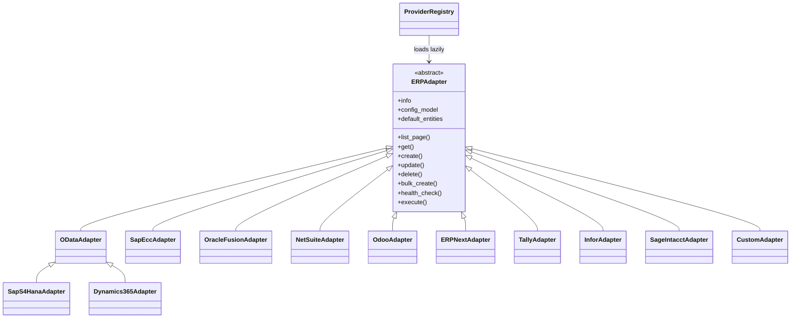
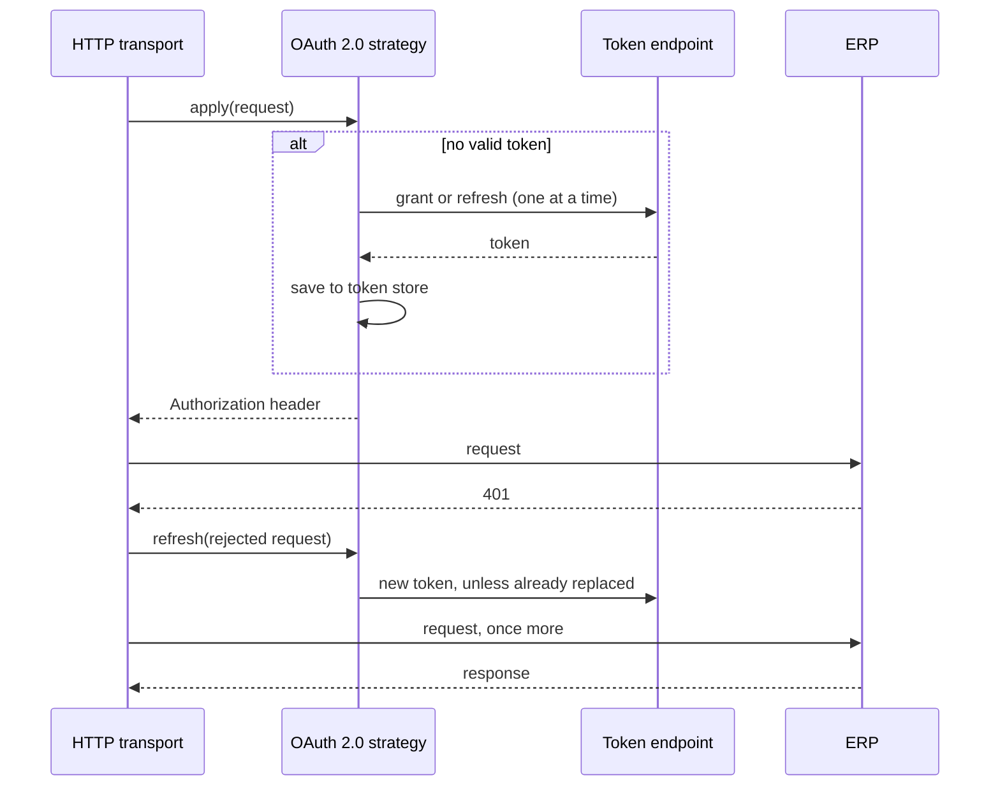
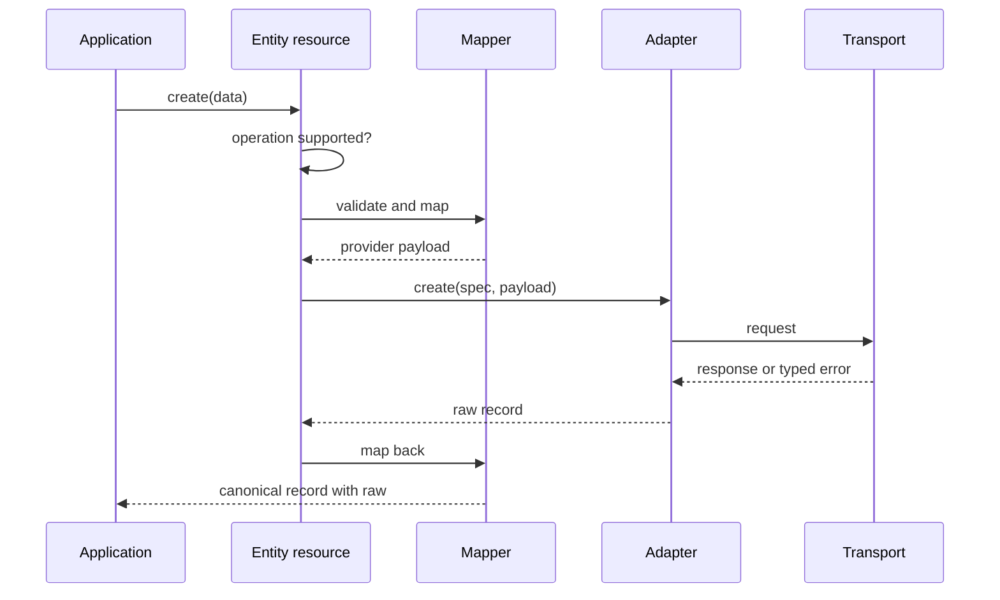
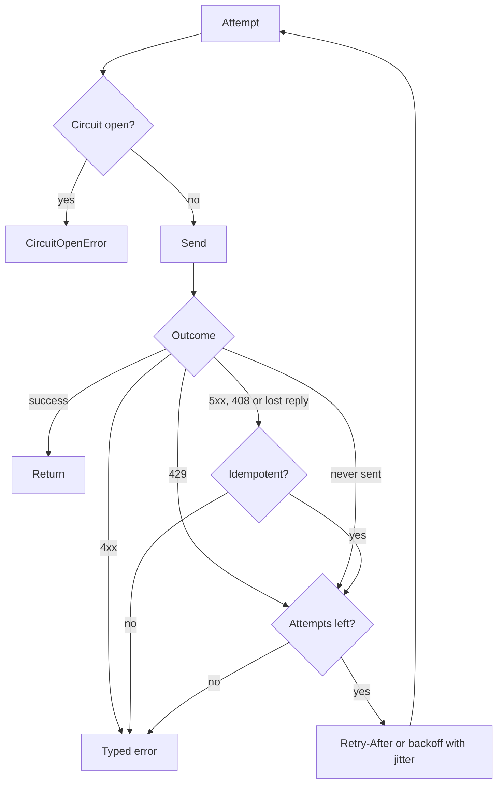
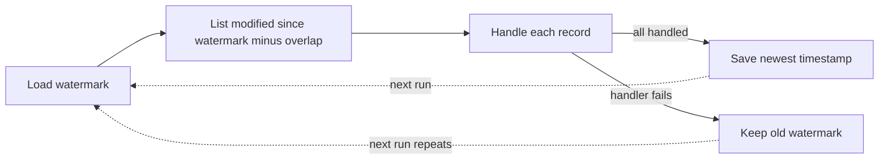

# Introduction and architecture

`py-erp-bridge` gives applications one typed interface to ten ERP systems. An
application works with canonical models (`Customer`, `Invoice`, ...); an adapter per provider
translates them. The original payload always stays available in `record.raw`.

## Layers

| Layer | Package | Responsibility |
|---|---|---|
| Public SDK | `py_erp_bridge`, `client` | Sync and async clients, tenants |
| Core | `core` | Adapter contract, queries, mapping, bulk, sync, registry |
| Providers | `providers` | One adapter per ERP |
| Authentication | `auth` | Strategies and token handling |
| Transport | `transport` | HTTP, OData, XML/SOAP, RFC |
| Resilience | `resilience` | Retry, circuit breaker, rate limits |
| Models | `models` | Canonical records |
| Configuration | `config` | Validated settings |
| Observability | `observability` | Logging and metrics |
| Webhooks | `webhooks` | Verification and dispatch |
| Exceptions | `exceptions` | Error hierarchy |

The core never refers to a provider, so an eleventh one needs no change in it.

## System

## Provider adapters

## Authentication

## Request and response

## Retry and errors

## Synchronization

## Decisions

- **One async implementation.** The blocking client runs it on a private event loop thread.
  There is no second code path to keep in step, and it works inside notebooks.
- **Mappings are data.** `EntitySpec` describes paths, keys and fields, so a tenant can adjust
  them in configuration.
- **Refuse rather than guess.** A field, filter or sort that a provider cannot express raises an
  error. An unexpected response body is never read as an empty list.
- **Evidence is recorded.** Every mapping states how well it is backed; see
  [capabilities](capabilities.md).
