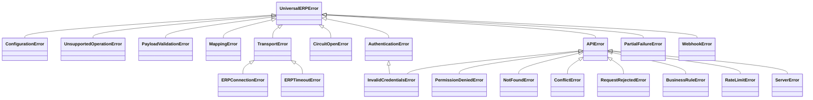

# Retry and error handling



`APIError` carries `status_code`, `code`, `request_id`, `retry_after` and a truncated `body`.

## What is retried

| Failure | Idempotent request | Other request |
|---|---|---|
| Connection not established | yes | yes |
| 429 | yes | yes |
| 408, 500, 502, 503, 504 | yes | no |
| Timeout or reset after sending | yes | no |
| Other 4xx | no | no |

GET, PUT, PATCH, DELETE and read-only POSTs count as idempotent; creates do not, because repeating one
could create a duplicate. `Retry-After` is honoured up to `max_retry_after`; otherwise the delay is random
between zero and the exponential ceiling.

If a create ends in `TransportError` with `request_sent=True` its outcome is unknown: look the record
up before trying again. If your ERP or gateway deduplicates by header, set `idempotency_header` and pass
`idempotency_key=`; such creates are retried.

The circuit breaker opens after consecutive 5xx or network failures, then lets one probe through.

## Observability

```python
from py_erp_bridge.observability import configure_logging

configure_logging("INFO")  # JSON lines with request_id, path, status and duration
```

Bodies, query strings and credentials are never logged. Pass `metrics=` an object with
`observe_request(...)` to feed Prometheus or OpenTelemetry.
